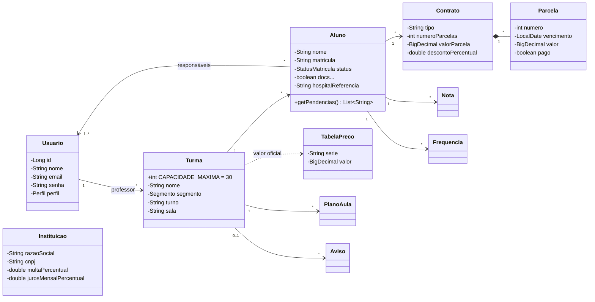

# 🌱 Semeando Digital

Sistema de Gestão Escolar (SGE) desenvolvido como projeto acadêmico (PjBL — Programação Orientada a Objetos, Engenharia de Software) para o **Centro Educacional Semeando**, escola comunitária de São Luís/MA que atende turmas do Maternal I ao 5º ano.

Hoje a escola gerencia matrículas, contratos e cobranças em arquivos de Word avulsos, o que gera retrabalho, valores de mensalidade divergentes da tabela oficial e risco à LGPD. O Semeando Digital centraliza essas informações em um único sistema, com perfis de acesso para **gestão/secretaria, professor, aluno e responsável**.

> ⚠️ Todos os dados do sistema são **fictícios** (LGPD, art. 14).

## Funcionalidades
- **Matrícula:** pré-matrícula, aprovação/rejeição, checklist de documentos e limite de 30 alunos por turma.
- **Financeiro:** cobrança dual (taxa de associado na Educação Infantil e mensalidade no Fundamental), validação contra a tabela oficial, multa e juros automáticos e boletos (integração CORA simulada).
- **Pedagógico:** diário de classe (chamada, notas e conteúdo), planos de aula e boletim.
- **Portal da família:** boletim, frequência, avisos, calendário, materiais e dados de emergência.
- **Conformidade:** log de auditoria, prazos de SMTT/Censo/Sistema Presença, exportação CSV e backup.

## Stack
| Camada | Tecnologias |
|---|---|
| Backend | Java 21, Spring Boot 3.3 (Web, Data JPA, Validation), H2 (banco em memória), Lombok, BCrypt |
| Frontend | React 18, React Router 6, Vite 5, CSS puro (layout responsivo) |
| Build | Maven, npm |

## Como rodar localmente

### Pré-requisitos
- [Java 17+](https://adoptium.net/) e [Maven 3.9+](https://maven.apache.org/)
- [Node.js 18+](https://nodejs.org/)
- [Git](https://git-scm.com/)

### 1. Clonar o repositório
```bash
git clone https://github.com/RoberthFurtadoDev/semeando-digital.git
cd semeando-digital
```

### 2. Iniciar
**Atalho:** no Windows, dê dois cliques em `iniciar.bat`; no Linux/Mac, rode `./iniciar.sh`.

**Ou manualmente, em dois terminais:**
```bash
# Terminal 1 — API em http://localhost:8080
cd backend
mvn spring-boot:run
```
```bash
# Terminal 2 — interface em http://localhost:5173
cd frontend
npm install
npm run dev
```

### 3. Acessar
Abra **http://localhost:5173** e entre com um dos usuários abaixo (senha `123456`), ou use os botões de acesso rápido da tela de login.

| Perfil | E-mail |
|---|---|
| Gestão / Secretaria | `gestor@exemplo.com` |
| Professor(a) | `professor@exemplo.com` |
| Aluno(a) | `aluno@exemplo.com` |
| Responsável | `responsavel@exemplo.com` |

> O banco H2 fica em memória: os dados de exemplo são recriados toda vez que o backend é iniciado.

## Estrutura
```
semeando-digital/
├── backend/             API REST (Spring Boot)
│   └── src/main/java/com/semeando/
│       ├── model/       entidades de domínio
│       ├── repo/        repositórios JPA
│       ├── service/     regras de negócio
│       ├── web/         controllers REST por perfil
│       └── config/      dados fictícios, CORS e erros
├── frontend/            interface (React + Vite)
│   └── src/
│       ├── pages/       telas por perfil
│       ├── components/  layout e componentes de UI
│       └── demo/        backend em JS para a versão online
└── docs/UML.md          diagramas UML
```

## UML
Diagrama de classes do domínio (o detalhamento e os demais diagramas estão em [`docs/UML.md`](docs/UML.md)):



## Licença
Projeto acadêmico, sem fins comerciais.
