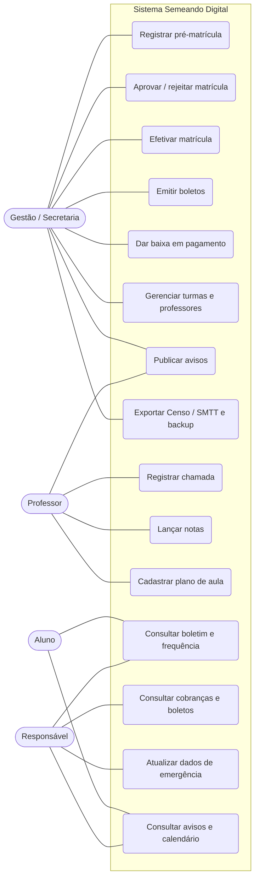
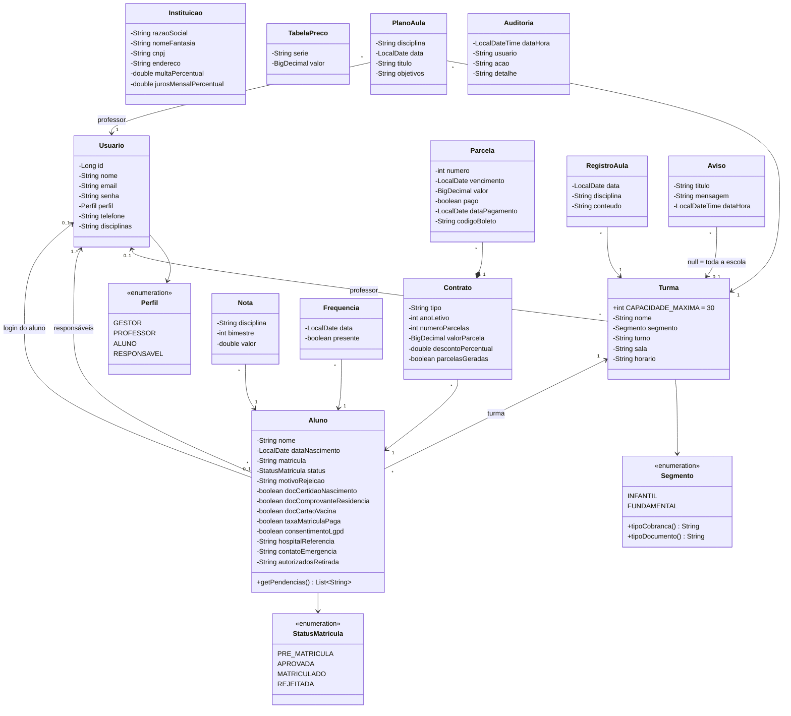
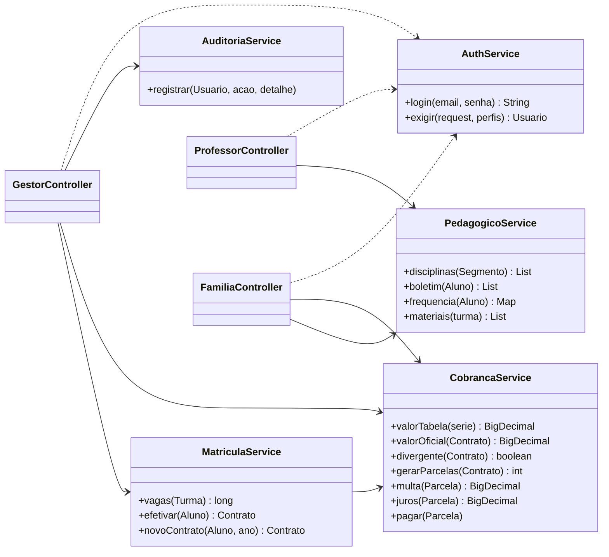
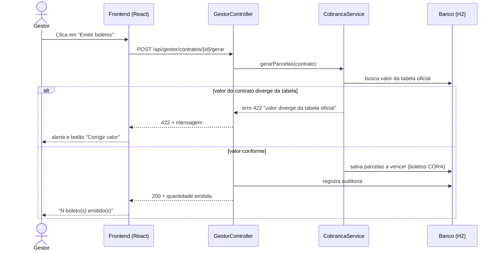
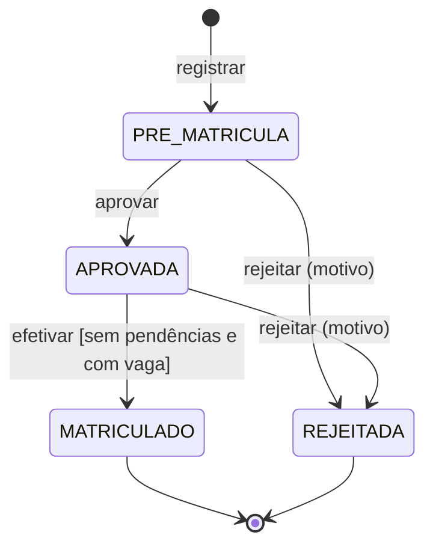

# UML — Semeando Digital

## 1. Casos de uso

## 2. Diagrama de classes (domínio)

## 3. Camada de serviços (regras de negócio)

## 4. Sequência — emissão de boletos com validação (RN04)

## 5. Estados da matrícula

